<div align="center">




<p>
  
  
  
  
  
</p>

**A premium, 3D-animated storefront for a Kanchipuram silk saree house.**
Temple maroon · antique gold · warm ivory.


</div>

## ✦ About

**SUPRIYA** is a luxury e-commerce front-end that feels like walking into a divine heritage silk showroom. It combines editorial layouts, depth-based 3D motion and fully working shopping interactions: wishlist, bag drawer, filters, product detail views and size selection.

## ✦ The nine sections

| # | Section | What it does |
|---|---------|--------------|
| 1 | **Hero** | Cinematic showroom reveal, mouse parallax, scrolling gold ticker |
| 2 | **Six Moods** | Six photos framed in gopuram-style temple arches, with quick view |
| 3 | **Try the Look** | Fashion-runway carousel; the centre model is sharp, the sides blur and fade. "In this look" panel with a 10% bundle offer |
| 4 | **Pick a Silk** | Fanned cards in bold colours that tilt toward the cursor and press down on click |
| 5 | **The Rack** | A chrome rail of hangers. The rail glides with the cursor, hangers swing in 3D, and filters slide pieces on and off |
| 6 | **Rack Detail** | Click a hanger for a focused view with Front/Back toggle, sizes 34–42, wishlist and next/previous arrows |
| 7 | **The Muse Film** | Short brand film in a gold bracketed frame with a sound toggle |
| 8 | **The Muse Reels** | 3D arc of five vertical reels; the centre reel plays and opens full screen |
| 9 | **The Bridal Collection** | Arch-topped bridal cards on a curved carousel with add-to-cart |

## ✦ Features

- **3D motion:** one-shot 3D section entrances, perspective hover tilt, cursor-driven rail glide
- **Smooth scrolling** with [Lenis](https://github.com/darkroomengineering/lenis), shared by every navigation link
- **Shopping flow:** wishlist, slide-out bag drawer, quantity controls, confetti on checkout
- **Ambient sound** toggle generated in the browser (no audio files)
- **Performance-minded:** videos and the rail animation pause off-screen, images lazy-load, no live blur on scrolling elements
- **Accessible motion:** respects `prefers-reduced-motion`; touch devices get normal scrolling carousels
- **Responsive** for desktop, tablet and mobile

## ✦ Tech stack

| Area | Tools |
|------|-------|
| Framework | React 19, TypeScript, Vite |
| Styling | Tailwind CSS v4 |
| Animation | Framer Motion, Lenis, CSS 3D transforms |
| UI extras | lucide-react, canvas-confetti |
| Linting | Oxlint |

## ✦ Getting started

**Requirements:** Node.js 20.19+ (22 recommended)

```bash
# 1. Clone
git clone https://github.com/YOUR_USERNAME/supriya.git
cd supriya

# 2. Install
npm install

# 3. Run the dev server
npm run dev
```

Then open the local URL printed in the terminal (usually `http://localhost:5173`).

> **Windows PowerShell blocks `npm`?** Use `npm.cmd install` and `npm.cmd run dev`, or run the commands in Command Prompt.

### Scripts

| Command | Purpose |
|---------|---------|
| `npm run dev` | Start the dev server with hot reload |
| `npm run build` | Type-check and create a production build in `dist/` |
| `npm run preview` | Preview the production build locally |
| `npm run lint` | Lint with Oxlint |

## ✦ Project structure

```text
.
├── public/
│   └── assets/
│       ├── crops/            # section photos (hero, moods, models, rack, reels, bridal…)
│       └── videos/           # muse_film.mp4 and the five reel clips
├── src/
│   ├── components/           # one component per section, plus drawers and modals
│   │   ├── Hero.tsx
│   │   ├── SixMoods.tsx
│   │   ├── TryTheLook.tsx
│   │   ├── PickASilk.tsx
│   │   ├── TheRack.tsx
│   │   ├── RackDetailModal.tsx
│   │   ├── TheMuseFilm.tsx
│   │   ├── TheMuseReels.tsx
│   │   ├── TheBridalCollection.tsx
│   │   ├── Section3D.tsx     # 3D entrance wrapper
│   │   ├── Navbar.tsx · Footer.tsx
│   │   └── CartDrawer.tsx · WishlistDrawer.tsx · StoreModal.tsx
│   ├── context/ShopContext.tsx   # bag, wishlist and UI state
│   ├── data/sarees.ts            # all products, looks, reels and bridal items
│   ├── utils/
│   │   ├── audio.ts              # click sounds and ambient drone
│   │   └── useSmoothScroll.ts    # Lenis setup and smoothScrollTo()
│   ├── App.tsx · main.tsx · index.css
├── index.html
└── vite.config.ts
```

## ✦ Customising

- **Products, prices, looks, reels:** edit `src/data/sarees.ts`.
- **Photos:** replace files in `public/assets/crops/` using the **same file names**. No code change is needed.
- **Videos:** replace `public/assets/videos/muse_film.mp4` and `reel_<name>.mp4` the same way. A reel's video name matches its image name, e.g. `reel_pachai_pattu.jpg` → `reel_pachai_pattu.mp4`.
- **Colours:** the palette is used directly in the components: maroon `#670d1e` / `#891b2e`, gold `#c59b27` / `#e5c365`, ivory `#faf8f5`.

## ✦ Notes

- Product photography and the sample clips are placeholders for development. Use your own licensed brand imagery before going live.
- Some rack pieces are colour variants of a few base photos. Swap in real product shots as they become available.

## ✦ Contributing

Issues and pull requests are welcome. For larger changes, please open an issue first to discuss what you would like to change.

<div align="center">


*Woven for the Divine.*

</div>
